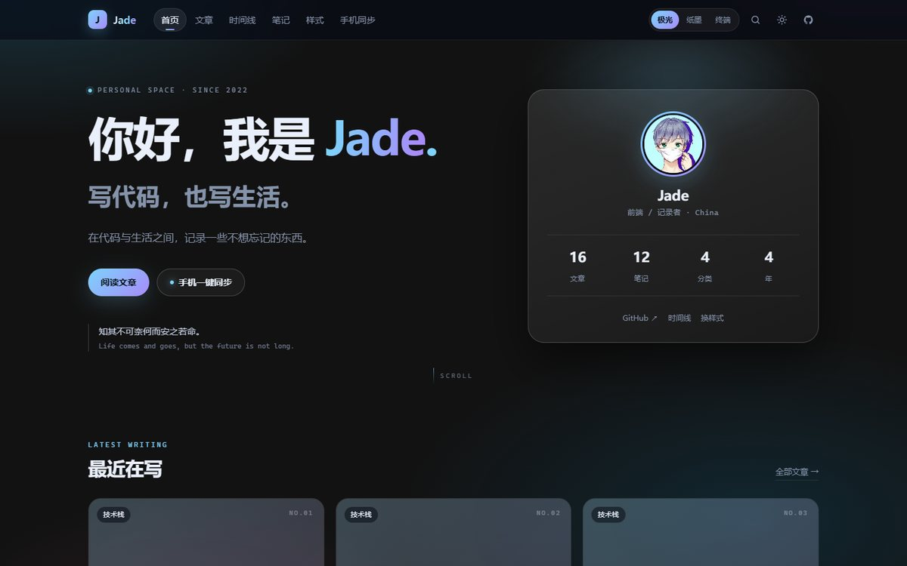
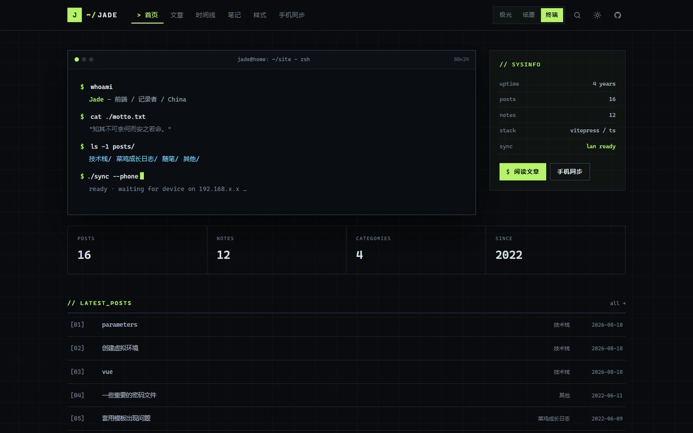

# Jade · 个人主页

从 `G:\blog0614`（VuePress 1.x + reco 主题）重构而来：**VitePress 1.6 + TypeScript + pnpm monorepo**，内置三套可切换的视觉样式，以及一个「手机一键同步到电脑」的局域网服务。

| 极光 Aurora | 纸墨 Paper | 终端 Mono |
| --- | --- | --- |
|  |  |  |

在线地址：<https://juyaohui.github.io/>

---

## 这次重构做了什么

- **换掉 VuePress 1.x**：VitePress 1.6、Vue 3.5、Vite 5、TypeScript、pnpm workspace，构建从几十秒降到 2 秒左右。
- **内容无损迁移**：16 篇文章、12 篇笔记、42 个图片资源、分类/标签/封面/日期全部保留（迁移脚本见 `scripts/migrate-content.mjs`，报告见 `docs/migration-report.md`）。
- **重新设计前端**：三套完整视觉方案（极光 / 纸墨 / 终端），共用同一套内容与路由，导航栏一键切换、记忆偏好；新增文章筛选、标签、时间线、全文搜索（MiniSearch，无需服务端）、404 页。
- **手机同步**：电脑端 `pnpm sync` 启动局域网服务，手机扫码打开同步面板，写笔记 → 一键同步 → 写入电脑 Markdown → `git commit` → `git push` → GitHub Actions 自动发布。
- **部署**：GitHub Actions + Pages，一条 `pnpm deploy` 完成建库、推送、启用 Pages、等待构建。

## 技术栈

| 层 | 选择 |
| --- | --- |
| 站点 | VitePress 1.6（Vue 3 + Vite 5），自定义主题，零第三方主题依赖 |
| 语言 | TypeScript（站点配置/data loader/同步服务全 TS） |
| 包管理 | pnpm 11 workspace（`apps/*`、`packages/*`） |
| 搜索 | MiniSearch 7，构建期生成索引，浏览器本地搜索 |
| 同步服务 | Fastify 5 + Zod 4 + SSE，`tsx` 直接运行 TS |
| 测试 | Vitest（Relay 的配对、鉴权、写入、冲突处理） |
| 部署 | GitHub Actions → GitHub Pages |

## 目录结构

```
apps/
  web/                     VitePress 站点
    .vitepress/
      config.ts            站点配置（base、head、markdown）
      site.ts              个人信息、分类、样式清单、导航
      data/*.data.ts       构建期内容加载器（文章 / 笔记）
      theme/               自定义主题：Layout、三套首页、文章页、同步页
      theme/styles/        base.css + prose.css + 三套样式 token
    src/
      posts/<分类>/*.md     文章（Markdown + frontmatter）
      notes/*.md            笔记/文档
      public/images/        图片资源（/images/...）
  relay/                   局域网同步服务
    src/server.ts           Fastify 路由：配对 / 同步 / SSE / 静态站点
    src/content.ts          Markdown 落盘、冲突保护
    src/git.ts              提交与推送
    src/store.ts            设备令牌、配对码、文件索引
    test/                   Vitest
packages/shared/           前后端共享的协议与类型
scripts/
  migrate-content.mjs      旧站迁移（一次性）
  deploy-gh.mjs            建库 + 推送 + 启用 Pages
  screenshot.mjs           三套样式截图
docs/
  SYNC.md                  同步服务设计说明
  migration-report.md      迁移明细
```

## 本地开始

要求：Node ≥ 20.19，pnpm ≥ 10。

```bash
pnpm install
pnpm dev          # http://localhost:5173
pnpm build        # 产物：apps/web/.vitepress/dist
pnpm test         # Relay 单元测试
```

> 如果系统里同时装了旧版 Node，请确保 `node -v` 是 20 以上再运行。

### Windows 快速启动（没装 pnpm 也能用）

如果系统 Node 还是 16、也没装 pnpm，可以直接双击项目根目录的 `sync.cmd`，它会自动寻找可用的 Node 20+ 运行时并启动同步服务。也可以在 PowerShell 里：

```powershell
cd G:\demoshowcase\blog
.\sync.cmd
```

`sync.cmd` 只负责启动手机同步服务；装好 Node 20+ / pnpm 之后，`pnpm dev`、`pnpm build` 等命令照常使用。

## 写内容

文章放在 `apps/web/src/posts/<分类>/<文件名>.md`，frontmatter 示例：

```yaml
---
title: "跌宕起伏的一年"
date: 2022-06-08
category: "随笔"
tags: ["daily"]
cover: "/images/essaypic/backiee-109922.jpg"
excerpt: "可选，不写会自动取正文首段"
---
```

图片放在 `apps/web/src/public/images/`，引用 `/images/xxx.jpg`（注意是 `src/public`，这是 VitePress 的 public 目录）。

## 三套样式

- 导航栏右上角 `极光 / 纸墨 / 终端` 实时切换，写入 `localStorage`。
- `/styles/` 页面有并排预览和「使用这个样式」。
- 改默认值：`apps/web/.vitepress/site.ts` 里的 `defaultStyle` / `defaultMode`。

## 手机一键同步

### 1. 电脑端启动服务

```bash
pnpm sync
```

终端会打印：

```
Jade 的电脑 · 手机同步服务
手机访问    http://192.168.1.2:5178/sync/?code=123456
配对码      123456
配对页面    http://192.168.1.2:5178/pair      ← 电脑上打开可看二维码
自动推送    GitHub origin/master · token 已加载
```

服务同时把构建好的站点跑在同一端口上，所以手机打开的是**和电脑同源**的页面，不受 HTTPS 混合内容限制。

### 2. 手机连接

- 手机和电脑连同一个 Wi-Fi；
- 用手机相机扫终端里的二维码，或浏览器打开 `http://<电脑IP>:5178/sync/`，输入 6 位配对码；
- 首次配对后令牌保存在手机里，下次直接进入面板；
- 浏览器菜单「添加到主屏幕」，就是一个全屏 App。

### 3. 一键同步

写标题/正文/标签 → 「加入待同步」→ 点中间的大圆按钮。电脑端会：

1. 按目标分类写入 `apps/web/src/posts/...`（或 `notes/...`）；
2. 若原文件在电脑上被改过，不覆盖，另存 `.conflict-时间戳.md`；
3. `git add` → `git commit` → `git push`（配置在 `apps/relay/relay.config.json`）；
4. GitHub Actions 构建并发布，手机端显示提交短 SHA。

推送失败（断网/token 失效）只影响发布，笔记已经安全落盘。

> **为什么公开站点里不能直接同步？** 浏览器会拦截 `https://` 页面访问局域网 `http://` 接口。同步面板由电脑端服务提供（同源 HTTP），公开主页只负责展示与说明。详见 [docs/SYNC.md](docs/SYNC.md)。

### 4. 配置

`apps/relay/relay.config.json`：

```json
{
  "name": "Jade 的电脑",
  "port": 5178,
  "siteUrl": "https://juyaohui.github.io/",
  "git": { "enabled": true, "remote": "origin", "branch": "master", "push": true }
}
```

- `RELAY_PORT` / `RELAY_PUSH=0` / `RELAY_GIT=0` 可临时覆盖。
- 推送 token 放在 `.secrets/github.token`（已 gitignore），也可用系统 git 凭据。
- 设备令牌哈希、配对码与文件索引保存在 `apps/relay/.relay/state.json`（已 gitignore）；删掉即可让所有手机重新配对。

## 部署到 GitHub Pages

### 方式 A：脚本（推荐，一次搞定）

1. 准备一个 Classic PAT，勾选 `repo`、`workflow`；或 Fine-grained PAT 给目标仓库 `Contents: RW`、`Pages: RW`、`Actions: RW`。
2. 保存到 `.secrets/github.token`（一行，不要引号）。
3. 运行：

```bash
pnpm deploy
# 或指定仓库 / token 文件
pnpm deploy -- --repo juyaohui/juyaohui.github.io --token-file D:/token.txt
```

脚本会：校验 token → 建库（若不存在）→ 启用 Pages（Actions 构建）→ 以正确 `BASE_PATH` 构建 → 提交并强制推送 → 等待 Actions 完成 → 打印线上地址。

### 方式 B：手动

```bash
git init -b master
git add -A
git commit -m "init"
git remote add origin https://github.com/<you>/<repo>.git
git push -u origin master
```

然后在仓库 **Settings → Pages → Build and deployment → Source** 选择 **GitHub Actions**。`.github/workflows/deploy.yml` 会自动识别用户站（`*.github.io`，base `/`）和项目站（base `/<repo>/`）。

> 仓库如果是 `juyaohui.github.io`，地址就是 <https://juyaohui.github.io/>；否则是 `https://juyaohui.github.io/<repo>/`。

## 常用命令

| 命令 | 说明 |
| --- | --- |
| `pnpm dev` | 本地开发 |
| `pnpm build` | 构建 |
| `pnpm sync` | 启动电脑端同步服务（会顺带托管构建产物） |
| `pnpm test` | Relay 测试 |
| `pnpm deploy` | 构建 + 推送 + 启用 Pages |
| `pnpm shot` | 三套样式 + 移动端截图（需要本机 Chrome/Edge） |

## 已知取舍

- **没有评论**：原 Valine/LeanCloud 评论已移除（服务端不可控且涉及第三方密钥），需要的话可以接 giscus（GitHub Discussions），改动只在文章页底部。
- **没有背景音乐**：原 bgm-player 自动播放体验差，已去掉；`bgm/` 也没有迁移。
- **旧密码文章**：原主题的「密码查看」是纯前端遮挡，不安全，已移除；相关文章正文仍然保留。
- **旧 URL**：文件名保持中文，旧站 pinyin permalink 未做 301 映射；站内链接已全部重算。
- **图片**：迁移时压缩到长边 1800px、JPEG q82，总体积从 ~31MB 降到 ~9.5MB。

## 迁移回滚

新项目完全独立，旧项目 `G:\blog0614` 未被修改。迁移脚本默认只补充缺失文件、不覆盖已有内容（保护手机同步进来的新笔记）；需要完全重建时运行 `pnpm migrate -- --force`。
