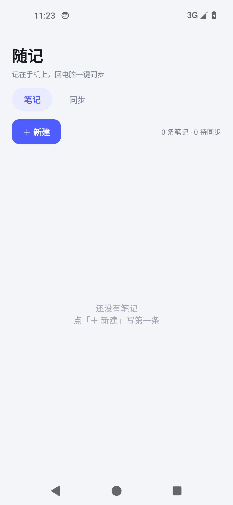
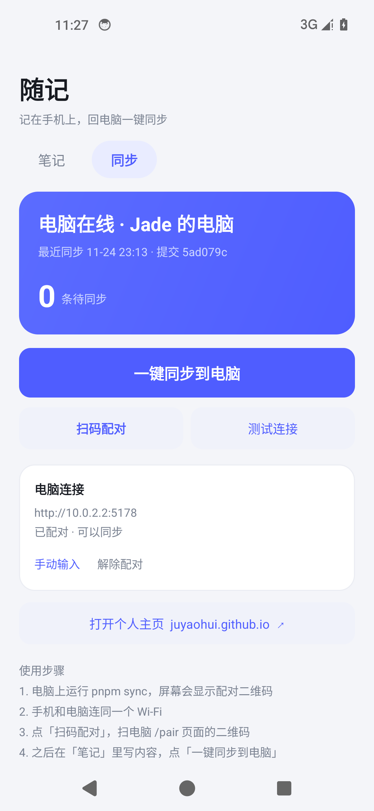
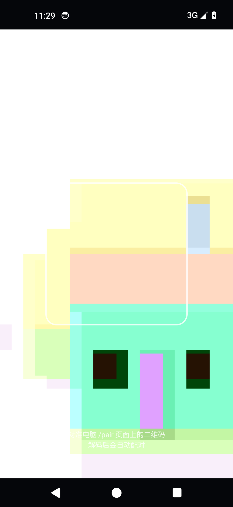

# 随记（Suiji）· Android App

手机本地记笔记，电脑开着的时候一键同步到 `juyaohui.github.io` 背后的那台电脑。原生 Java + WebView 无关，只有 614 KB。

- 安装包：`suiji-1.0.apk`（也可从 <https://juyaohui.github.io/sync/> 下载）
- 包名：`com.juyao.suiji`　版本：1.0（versionCode 1）
- 兼容：Android 7.0+（minSdk 24，targetSdk 34）
- 权限：`INTERNET`、`ACCESS_NETWORK_STATE`、`CAMERA`

| 笔记列表 | 同步面板 | 扫码配对 |
| --- | --- | --- |
|  |  |  |

## 功能

**笔记**
- 新建 / 编辑 / 长按删除；标题、正文、标签、分类（随笔 / 技术 / 笔记）
- 每次保存立即写入 SharedPreferences，杀进程、重启手机都不丢
- 列表显示摘要、分类、更新时间、同步状态

**同步**
- 电脑运行 `pnpm sync`，手机和电脑连同一个 Wi-Fi
- 点「扫码配对」扫电脑 `/pair` 页面的二维码（也可以手动输入 IP:端口 + 6 位配对码）
- 配对后显示「电脑在线 · 电脑名」、最近同步时间和提交 SHA
- 点「一键同步到电脑」：把未同步笔记 POST 给电脑，电脑写入 Markdown、git commit、push，GitHub Actions 发布
- 电脑离线时笔记留在本地，下次再同步；App 不做后台常驻

**其他**
- 同步面板里「打开个人主页」直接跳到 <https://juyaohui.github.io/>
- 没有账号、没有广告、没有云；数据只在手机和你的电脑上

## 怎么用

1. 手机浏览器打开 <https://juyaohui.github.io/sync/>，点「下载随记 APK」，或把 `suiji-1.0.apk` 传到手机安装。
2. 电脑上运行：

   ```powershell
   cd G:\demoshowcase\blog
   pnpm sync
   ```

   终端会显示二维码、局域网地址和 6 位配对码。

3. 手机打开「随记」→ 同步 → 扫码配对（扫电脑 `/pair` 页面或终端里的二维码）。
4. 回到「笔记」写内容 → 保存 → 同步 → 一键同步到电脑。

> 必须是同一个 Wi-Fi / 局域网；电脑和手机不在同一网段、开了 AP 隔离或 VPN 时会连不上。

## 技术实现

- 纯 Java，不依赖 Gradle / Android Studio / AndroidX
- 构建：`aapt2` → `javac --release 8` → `d8` → 打包 → `zipalign` → `apksigner`
- 二维码：ZXing core 3.5.3 + 系统 Camera API（`onPreviewFrame` → `PlanarYUVLuminanceSource` → `MultiFormatReader`）
- 网络：`HttpURLConnection`，JSON 用系统 `org.json`
- 存储：`SharedPreferences`（`suiji_notes` 笔记，`suiji_conn` 配对信息）

### 重新打包

```powershell
cd G:\demoshowcase\blog\android
.\build.ps1
```

- 默认复用 `C:\Users\juyao\Documents\deepseek-harness\default-workspace\android-apk\tools` 里的 JDK 17 + SDK 34；可用 `-Tools` 或 `ANDROID_TOOLCHAIN` 指定
- 第一次构建会下载 `libs/zxing-core-3.5.3.jar`（约 600 KB）
- 签名复用 `..\signing\xiaoben.keystore`（alias `xiaoben`，口令 `xiaoben123`），升级必须用同一个证书
- 构建后自动复制到 `apps/web/src/public/downloads/suiji-1.0.apk`，随站点一起发布
- 改版本号：`.\build.ps1 -VersionName 1.1 -VersionCode 2`

### 接口

与 `apps/relay` 的协议一致：

| 方法 | 路径 | 说明 |
| --- | --- | --- |
| GET | `/api/health` | 判断电脑是否在线 |
| GET | `/api/info` | 电脑名、最近同步、最近提交 |
| POST | `/api/pair` | `{code, device:{name,platform}}` → `{token, device}` |
| POST | `/api/sync` | Bearer token；`{deviceId, clientTime, items}` |

写 Markdown 的目录映射：随笔 → `apps/web/src/posts/随笔`，技术 → `posts/技术栈`，笔记 → `notes/移动端`。

## 已知限制

- 只在 App 打开时同步；没有后台服务/通知
- 只同步文本（Markdown），没有图片上传
- 局域网明文 HTTP；token 存在手机私有 SharedPreferences 中，Root 后可读
- 扫码需要相机权限；模拟器里只能用虚拟场景，真机效果更好
- 换签名证书后无法覆盖安装，只能卸载重装（会丢本地笔记）

## 数据位置

`/data/data/com.juyao.suiji/shared_prefs/suiji_notes.xml`（笔记 JSON）和 `suiji_conn.xml`（配对信息）。没 Root 可以用：

```bash
adb shell run-as com.juyao.suiji cat shared_prefs/suiji_notes.xml
```
